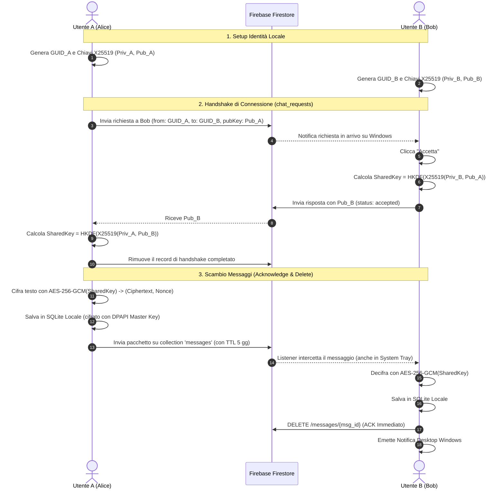

# SecureChat E2EE — Client di Messaggistica Personale per Windows

Un'applicazione desktop Windows per la messaggistica personale sicura, con crittografia **End-to-End (E2EE)** e architettura **Serverless** basata su Google Cloud Firestore.

---

## 🔒 Principi di Sicurezza e Crittografia

1. **Protocollo Crittografico E2EE Asimmetrico + Simmetrico:**
   - **Key Agreement:** Curva ellittica **X25519** (Curve25519) per lo scambio chiavi Diffie-Hellman asimmetrico.
   - **Key Derivation Function:** **HKDF-SHA256** (RFC 5869) per derivare una chiave simmetrica a 256 bit dallo shared secret.
   - **Cifratura dei Messaggi:** **AES-256-GCM** (Galois/Counter Mode con Nonce crittografico a 96 bit univoco per ogni messaggio e Auth Tag a 128 bit).
   - **Trasparenza del Cloud:** Google Firebase / Firestore vede **esclusivamente testo cifrato binario (Base64)** e Nonce. Nessun server possiede le chiavi di decifratura.
2. **Architettura di Routing "Acknowledge & Delete":**
   - Nessun messaggio viene archiviato nel cloud.
   - Non appena il client destinatario (anche se minimizzato nella System Tray di Windows) rileva un messaggio in transito:
     1. Scarica il pacchetto cifrato.
     2. Lo salva nel database SQLite locale sul PC (cifrato a riposo).
     3. Invia una conferma (ACK) a Firestore **cancellando immediatamente** il documento dal server.
3. **Fallback di Emergenza TTL (5 Giorni):**
   - Nel caso in cui il PC destinatario rimanga offline per più di 5 giorni, la policy TTL nativa di Google Cloud Firestore cancella automaticamente i messaggi non recapitati, impedendo qualsiasi accumulo di dati.
4. **Storage Locale Cifrato a Riposo (Data-at-Rest):**
   - Tutti i dati salvati su disco (`%APPDATA%/SecureChatE2EE/chat_vault.db`), inclusi la chiave privata dell'utente, le chiavi di sessione e lo storico dei messaggi, sono protetti con AES-256-GCM tramite una Master Key cifrata con **Windows DPAPI (Data Protection API)**, legata all'utente di sistema corrente.

---

## 📁 Struttura del Progetto

```
messaggi_criptati/
├── app/
│   ├── crypto/
│   │   ├── __init__.py
│   │   └── cipher_engine.py       # X25519, HKDF-SHA256, AES-256-GCM, DPAPI
│   ├── database/
│   │   ├── __init__.py
│   │   └── local_storage.py       # SQLite locale con cifratura a riposo
│   ├── network/
│   │   ├── __init__.py
│   │   └── firebase_client.py     # Firestore Handshake, Listener e Acknowledge & Delete
│   ├── ui/
│   │   ├── __init__.py
│   │   ├── main_window.py         # Interfaccia grafica CustomTkinter (Fluent / Dark Mode)
│   │   └── tray_icon.py           # Gestione background System Tray con Pystray
│   └── utils/
│       ├── __init__.py
│       └── notifier.py            # Notifiche native Windows Action Center
├── assets/
│   ├── app_icon.png               # Icona PNG
│   └── app_icon.ico               # Icona ICO multi-risoluzione per Windows
├── config/
│   └── serviceAccountKey.json.example  # Modello credenziali Firebase
├── packaging/
│   ├── pyinstaller.spec           # Specifica PyInstaller per compilazione .exe
│   └── installer.iss              # Script Inno Setup per il Setup.exe guidato
├── main.py                        # Entry point dell'applicazione
├── requirements.txt               # Dipendenze Python
├── firestore.rules                # Regole di sicurezza Firestore
├── firestore_ttl_guide.md         # Guida configurazione TTL 5 giorni
├── create_icons.py                # Generatore icone vettoriali
└── build_exe.bat                  # Script batch per build automatica 1-click
```

---

## 🚀 Istruzioni di Installazione e Avvio Rapido

### 1. Prerequisiti
- Windows 10 o Windows 11 (64-bit)
- Python 3.10 o successivo

### 2. Installazione delle Dipendenze
Apri PowerShell o il Prompt dei Comandi nella cartella del progetto:
```powershell
pip install -r requirements.txt
```

### 3. Configurazione di Firebase Firestore
1. Crea un progetto gratuito su [Firebase Console](https://console.firebase.google.com/).
2. Abilita il database **Cloud Firestore** in modalità Produzione o Test.
3. Vai su **Impostazioni Progetto** (icona ingranaggio) > **Account di servizio**.
4. Clicca su **Genera nuova chiave privata** e scarica il file JSON.
5. Rinomina il file scaricato in `serviceAccountKey.json` e inseriscilo nella cartella `config/` (oppure selezionalo direttamente dall'interfaccia dell'applicazione tramite il tasto **Configura**).
6. Applica le regole di sicurezza incollando il contenuto di [firestore.rules](file:///firestore.rules) nella scheda **Regole** di Cloud Firestore.
7. Configura il TTL di 5 giorni seguendo [firestore_ttl_guide.md](file:///firestore_ttl_guide.md).

### 4. Avvio in modalità Sviluppo
```powershell
python main.py
```

---

## 📦 Compilazione dell'Eseguibile (.exe) e Installer

Per generare l'eseguibile standalone e l'installer guidato con icona sul desktop e menu Start:

### Metodo Automatico (Raccomandato):
Esegui con doppio click lo script:
```cmd
build_exe.bat
```

### Metodo Manuale:

1. **Genera l'eseguibile con PyInstaller:**
   ```powershell
   cd packaging
   pyinstaller --clean --noconfirm pyinstaller.spec
   cd ..
   ```
   L'eseguibile compilato e tutte le dipendenze saranno disponibili in:
   `dist/SecureChatE2EE/SecureChatE2EE.exe`

2. **Genera l'installer guidato Setup.exe con Inno Setup:**
   Installa [Inno Setup 6](https://jrsoftware.org/isdl.php) ed esegui:
   ```cmd
   "C:\Program Files (x86)\Inno Setup 6\ISCC.exe" packaging\installer.iss
   ```
   L'installer finale verrà creato in:
   `dist_installer\SecureChat_Setup_v1.0.exe`

---

## 🛡️ Flusso Operativo Handshake ed E2EE


